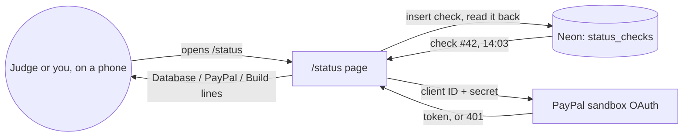
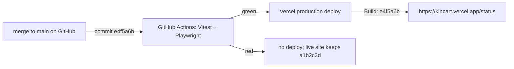
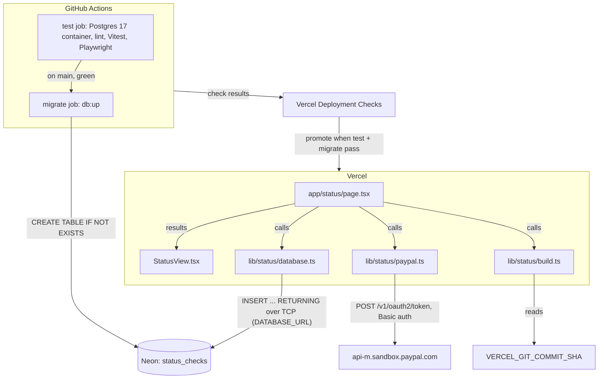
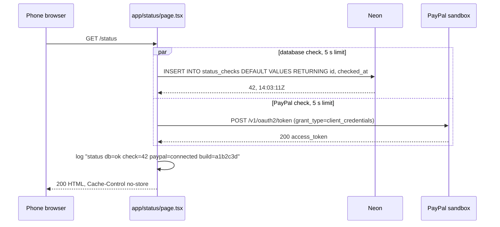
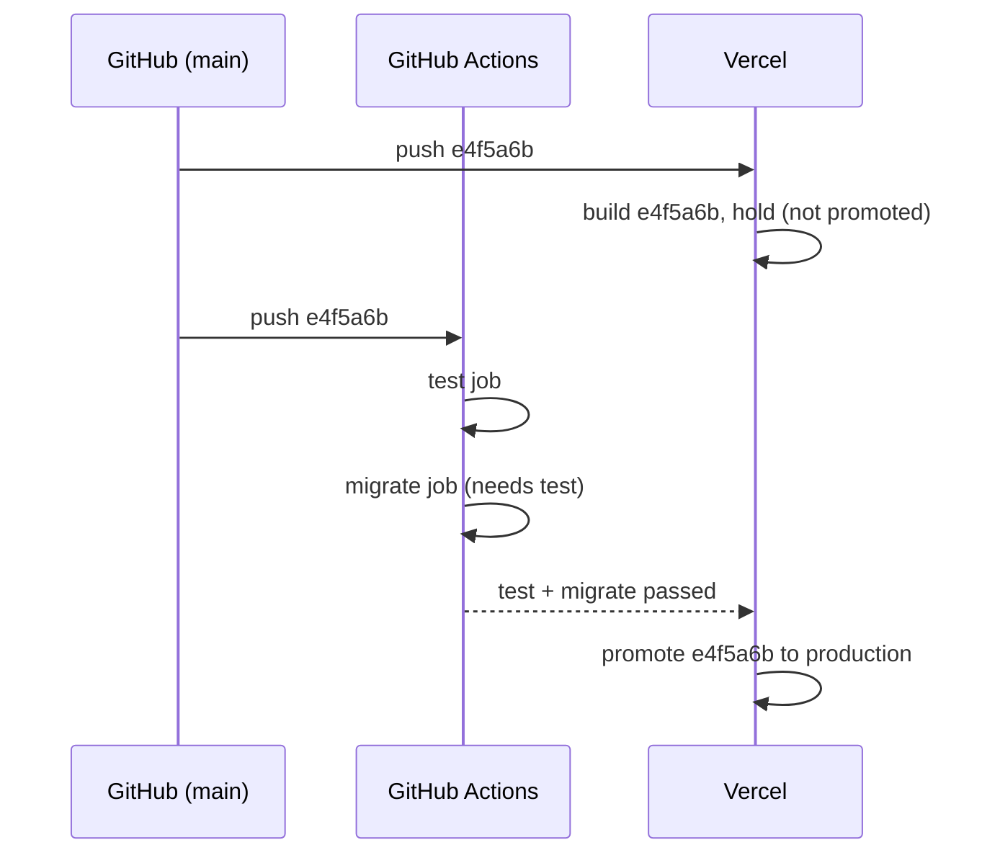
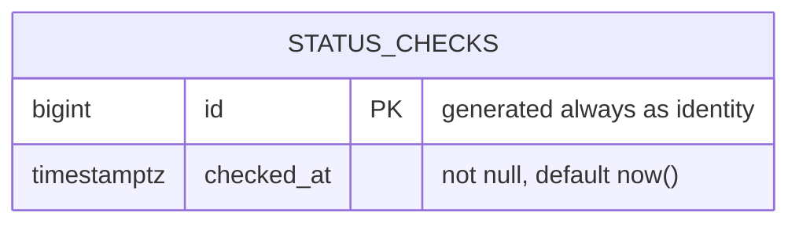

# Skeleton

**Version:** v1 · **Status:** Built · **Type:** Skeleton · **Project type:** Web UI

**Shape doc:** docs/specs/shop-together/shape.md
**Depends on:** None
**Page:** none. Skipped: you read the `.md` directly.

A `/status` page, live on Vercel, that writes a row to Neon, gets a PayPal sandbox token, and says plainly whether each one worked. It ships first because the repo is empty, and every later slice needs the deploy, the database, the PayPal keys and CI to already work.

## Problem

Nothing exists yet. The first real slice, `approve-and-pay`, rests on four things nobody has proven from a live host: the deploy, the database, the PayPal sandbox keys, and a CI run that blocks a broken build. Finding a broken one in week three would eat hours the project doesn't have (22 to 44 in total, shape O10).

## Slice test

| Check                         | Result |
| ----------------------------- | ------ |
| Cuts every layer it needs     | yes: `/status` page, server route, Neon table, PayPal sandbox call, GitHub Actions, Vercel deploy |
| One e2e test walks it         | yes: Playwright opens `/status` at phone width, checks all three lines, reloads, and sees the check number go up (scenarios 1 and 2). Scenarios 3 and 4 run the same page with broken config. Scenario 5 is the CI gate itself |
| Worth shipping alone          | no, by design. A walking skeleton helps nobody on its own; its value is that slices 1 to 4 start on proven rails |
| Fits (≤5 scenarios, ≤2 areas) | yes: 5 scenarios, two areas (status page, CI and deploy) |

**Path:** full. New stack, new dependencies, a new page.

## Stack

The decision record for the whole project, chosen at pause 1 on 2026-10-12.

| Piece | Choice | Rejected |
| ----- | ------ | -------- |
| Language and framework | Next.js + TypeScript | Python FastAPI + HTML templates |
| Host | Vercel Hobby, free | Render free (sleeps; free Postgres deleted after 30 days), not hosted |
| Database | Neon Postgres, free | Supabase free, Render Postgres free |
| CI | GitHub Actions | none |
| Tests | Vitest (unit) + Playwright (e2e) | Playwright only |
| Package manager | pnpm | npm |
| License | MIT | Apache-2.0 |

Recorded as D2 to D9 in DECISIONS.md.

## Flow



Opening `/status` writes one check row and reads it back, asks PayPal sandbox for a token, and shows one plain line for each result, plus the commit that's live.



A commit reaches the live URL only after its tests pass. A red run leaves the last green build in place.

## Acceptance criteria

```gherkin
Scenario: Both rails are up
  Given the app is live at https://kincart.vercel.app with its Neon database and PayPal sandbox keys set
  And the live build is commit a1b2c3d
  When a judge opens /status on a phone 390 pixels wide
  Then the page shows "Database: OK, check #42 at 14:03"
  And it shows "PayPal sandbox: connected"
  And it shows "Build: a1b2c3d"
  And nothing on the page scrolls sideways

Scenario: Every visit writes a fresh check
  Given /status last showed "check #42"
  When the judge reloads the page
  Then it shows "check #43" with the new time

Scenario: Database is down
  Given the Neon database refuses connections
  When a judge opens /status
  Then the page still loads
  And it shows "Database: not reachable"
  And the PayPal line shows its own result
  And no connection string or password appears on the page

Scenario Outline: PayPal keys missing or wrong
  Given PAYPAL_CLIENT_SECRET is <state>
  When a judge opens /status
  Then it shows "PayPal sandbox: <message>"
  And the Database line shows its own result
  And no key value appears on the page

  Examples:
    | state   | message        |
    | not set | not configured |
    | wrong   | keys rejected  |

Scenario: A failing build never reaches the live demo
  Given the live /status shows "Build: a1b2c3d"
  When commit e4f5a6b lands on main and its e2e test fails
  Then GitHub Actions marks e4f5a6b as failed
  And the live /status still shows "Build: a1b2c3d"
```

## Scope

**In:**
- `/status` page: three plain lines (Database, PayPal sandbox, Build), readable at 390 px. Anyone can open it. It shows no secrets.
- One table holding one row per check.
- A PayPal sandbox token request as the PayPal check. No orders, no vault.
- GitHub Actions running Vitest and Playwright on every push and pull request.
- Vercel production deploys only from a green `main`.
- A public GitHub repo with an MIT `LICENSE`, a `.env.example`, and README steps to run it locally (the rules require them).

**Out:**
- Any product screen, and the vault: `approve-and-pay`.
- Styling and the design system: `/design-system` runs before `approve-and-pay`. `/status` stays plain.
- Logins and accounts: `approve-and-pay` (shape O8).
- AI and product search: `find-and-explain`.
- Alerts when `/status` goes red, and a custom domain: no slice planned.

## Interface

`GET /status` returns one server-rendered HTML page. It is never cached (`Cache-Control: no-store`), because scenario 2 needs a fresh check on every reload. It always answers HTTP 200: the text carries the result, and no scenario needs a monitoring status code.

The page is a heading, "Shop-together status", over three label and value lines:

| Line | Value | When |
| ---- | ----- | ---- |
| Database | `OK, check #42 at 14:03 UTC` | the row was written and read back |
| Database | `not configured` | `DATABASE_URL` is unset |
| Database | `not reachable` | connecting, inserting or reading fails |
| PayPal sandbox | `connected` | the token request answers 200 |
| PayPal sandbox | `not configured` | `PAYPAL_CLIENT_ID` or `PAYPAL_CLIENT_SECRET` is unset |
| PayPal sandbox | `keys rejected` | the token request answers 401 |
| PayPal sandbox | `not reachable` | timeout, network error, or 5xx |
| Build | first 7 characters of the deployed commit | running on Vercel |
| Build | `local` | running anywhere else |

Failure values are bold. The page never shows an error message, a stack trace, a key or a connection string; the detail goes to the server log only.

Type and colour: system font; 20px heading, 16px labels, 18px values, monospace commit. Colours are the browser's own (`color-scheme: light dark` with `Canvas` and `CanvasText`), so light and dark both work and no colour carries meaning. Labels measured 21:1 against the background in Chrome. A label and value grid with 16px side padding fits 390px with no sideways scroll, checked in Chrome.

States: no loading state, because the server sends the page complete; a Neon wake-up shows as the browser's own spinner. No empty state. Nothing is interactive, so there are no hover or focus states.

Craft checks: a one-line "status page" prompt gives green and red pill badges on cards; this is a plain definition list on purpose, since only you and the judges see it. Reference: Vercel's restraint, monochrome with hierarchy from type size alone. At three lines it holds up.

**Motion tier:** 0

**Components used:** none. Plain `main`, `h1` and `dl`. There is no design system yet; its gate starts at `approve-and-pay`, as agreed at pause 1.

**Preview:** docs/design/skeleton/preview.html

## Technical plan

### Approach

A fresh `create-next-app` project. `/status` is a server component that runs the database and PayPal checks in parallel, each with a 5-second limit, logs one line, and renders a pure `StatusView`. Production deploys through Vercel's GitHub integration, and Vercel's Deployment Checks hold each one until the GitHub Actions `test` and `migrate` jobs pass. That is scenario 5, and it settles O4.

Relies on: D1, D2, D3, D4, D5, D6, D7, D8, D9, D10, D11, D12, D13, D14



The secrets stay on the server: `DATABASE_URL` goes only to Neon, and the PayPal client ID and secret only to PayPal. The browser receives the rendered lines and nothing else.



One request writes one row and fetches one token at the same time, then renders. A failed or slow check becomes its own line, and the other check still reports.



Vercel builds every push straight away but only puts it on the production URL once both jobs are green. A red job leaves the last green build live.

### Changes

| File | What changes | Why |
| ---- | ------------ | --- |
| `package.json`, `pnpm-lock.yaml` | `create-next-app` with TypeScript, App Router and ESLint, no Tailwind (`/design-system` decides styling). Adds `pg`, `@types/pg`, `vitest`, `@playwright/test`. Scripts: `dev`, `build`, `start`, `lint`, `test`, `test:e2e`, `db:up`, `db:down`; `db:up` and `db:down` read `.env.local` with `node --env-file-if-exists`. `"packageManager": "pnpm@9.0.0"`, `"engines": {"node": "24.x"}` | all; D7 pin |
| `tsconfig.json`, `eslint.config.mjs`, `next.config.ts` | `create-next-app` defaults, except `next.config.ts` drops its `cacheComponents` and `partialPrefetching` defaults, which nothing here uses | all |
| `app/layout.tsx` | `lang="en"`, title "Shop-together", no web fonts | 1 |
| `app/page.tsx` | redirects to `/status`, replacing the sample page | 1: no boilerplate on the live URL |
| `app/status/page.tsx` | server component, rendered per request (`await connection()`). Runs `checkDatabase` and `checkPaypal` with `Promise.all`, reads `buildLabel`, logs one line, renders `StatusView` | 1 to 4 |
| `app/status/StatusView.tsx` | pure component: three results in, the `dl` from the Interface table out. Failures bold | 1, 3, 4 |
| `app/status/status.css` | the `.status` rules from the preview | 1 (390 px) |
| `lib/status/database.ts` | `checkDatabase()`: no `DATABASE_URL` gives `not configured`. Otherwise it uses a `pg` `Client` per call (connect, `INSERT ... RETURNING id, checked_at`, end), 5 s connection and query timeouts. Any error gives `not reachable`, and the error code goes to the log only | 1, 2, 3 |
| `lib/status/paypal.ts` | `checkPaypal()`: a missing ID or secret gives `not configured`. Otherwise `fetch` POST to `https://api-m.sandbox.paypal.com/v1/oauth2/token` with Basic auth and `AbortSignal.timeout(5000)`. 200 gives `connected`, 401 gives `keys rejected`, anything else or a throw gives `not reachable` | 1, 4 |
| `lib/status/build.ts` | `buildLabel()`: the first 7 characters of `VERCEL_GIT_COMMIT_SHA`, or `local` | 1 |
| `lib/status/database.test.ts`, `paypal.test.ts`, `build.test.ts`, `app/status/StatusView.test.tsx` | Vitest; see Test plan | 2, 3, 4 |
| `db/migrations/0001_status_checks.up.sql`, `.down.sql` | create and drop `status_checks` | 1, 2 |
| `scripts/migrate.mjs` | `up` runs every `*.up.sql` in order, each written to be safe to rerun. `down` runs only the highest-numbered `*.down.sql`. Plain Node with `pg`, so no TypeScript runner is needed | 1, 2, reverse path |
| `scripts/migrate.test.ts` | up, down, up against the test database | reverse path |
| `playwright.config.ts`, `e2e/status.spec.ts` | `webServer: pnpm build && pnpm start`, ready when port 3000 opens (a URL probe follows the `/` redirect); Chromium at 390×844; the one e2e | 1, 2 |
| `vitest.config.mts` | node environment, excludes `e2e/`, runs files one at a time (the migrate test drops the table the database test writes to), loads `.env.local` when present | — |
| `.github/workflows/ci.yml` | `test` job on every push and pull request: Node 24, pnpm, `postgres:17` service, `db:up`, `lint`, `test`, Playwright Chromium, with `PAYPAL_CLIENT_ID`/`PAYPAL_CLIENT_SECRET` from repo secrets and `VERCEL_GIT_COMMIT_SHA=${{ github.sha }}`. `migrate` job on `main` only, `needs: test`, runs `db:up` with the `NEON_DATABASE_URL` secret | 5 |
| `.env.example` | `DATABASE_URL`, `PAYPAL_CLIENT_ID`, `PAYPAL_CLIENT_SECRET`, empty | README |
| `LICENSE` | MIT, 2026, Dzafran Bustaman | rules; D8 |
| `README.md` | a `## Setup` section below the zuko block: the four accounts, the env vars, `pnpm db:up`, `pnpm dev`, `pnpm test` | rules |
| `.gitignore` | Next.js defaults plus `.env*.local`, keeping `docs/specs/.pages/` | secrets |

Reusing: nothing. The repo is empty.

Set by hand at `/build` (dashboards, not files): Vercel project linked to the GitHub repo; Neon via the Vercel marketplace, which sets `DATABASE_URL`; PayPal keys in Vercel env (Production) and GitHub secrets; "Automatically expose System Environment Variables" on; Deployment Checks requiring `test` and `migrate`. Local development uses a Postgres 17 container or a Neon connection string in `.env.local` (README Setup).

### Data



**Migration:** expand only. A new table with nothing to backfill and nothing to switch. `CREATE TABLE IF NOT EXISTS status_checks (...)`.
**Reverse:** `pnpm db:down` runs `DROP TABLE IF EXISTS status_checks;`. `scripts/migrate.test.ts` runs up, down, up and checks the table exists only when it should.

### Earn-it

| Added | Triggered by |
| ----- | ------------ |
| `pg` | scenarios 1 to 3 need one Postgres client that works on Vercel and against CI's plain Postgres container (D12, D13) |
| `vitest` | scenarios 3 and 4 are four failure modes each; unit tests prove them without breaking real config (D6) |
| `@playwright/test` | the e2e walks scenarios 1 and 2 in a phone-sized browser (D6) |
| `scripts/migrate.mjs` | the table must exist in Neon, CI and local, and the reverse path must be tested |
| `migrate` CI job | production schema changes only after tests pass (D11) |
| `StatusView` split from the page | the wording table and "no secret on the page" get tested without a database or PayPal (scenarios 3, 4) |

Not added: an ORM, the PayPal SDK, a logger, an env-validation library, a migration-tracking table.

### Non-functionals

|                      |                                                                               |
| -------------------- | ----------------------------------------------------------------------------- |
| **Load**             | A few visits a day: you while building, judges Dec 1 to 15. |
| **Breaks first**     | Neon's free compute-hours, not traffic. Each visit keeps Neon awake for 5 minutes. Anything hitting `/status` more often than every 5 minutes all month (an uptime monitor, a crawler) costs about 182 compute-hours at 0.25 CU, against 100 free, and Neon stops until the next month (O5). Fix: no uptime monitor; if a crawler does it, stop writing a row on every hit. Rows themselves are about 40 bytes; 0.5 GB is millions of visits. |
| **Security surface** | Anyone can call `GET /status`. It reads no input: no query string, body or cookies. Secrets are `DATABASE_URL`, `PAYPAL_CLIENT_ID` and `PAYPAL_CLIENT_SECRET` (Vercel env), and `NEON_DATABASE_URL` plus the PayPal pair (GitHub secrets). It stores one row per visit, an id and a time, with no personal data. Error detail goes to the server log only. |
| **Proof it works**   | Vercel runtime log, one line per visit: `status db=ok check=42 paypal=connected build=a1b2c3d`. In prod, opening `/status` shows the same. |
| **Rollout**          | No flag: this is the first deploy and nothing exists to hide. Rollback: revert on `main`, and the checks promote the revert. Schema: `pnpm db:down` against Neon. |

### Test plan

| Scenario | Test | Command |
| -------- | ---- | ------- |
| 1 Both rails up | `e2e/status.spec.ts`: three lines, `Build` equals the first 7 of `GITHUB_SHA` in CI, no sideways scroll at 390 px, `Cache-Control` contains `no-store` | `pnpm test:e2e` |
| 2 Fresh check | `e2e/status.spec.ts` (reload, check number +1); `lib/status/database.test.ts` (two calls, ids increase) | `pnpm test:e2e`, `pnpm test` |
| 3 Database down | `lib/status/database.test.ts`: unset gives `not configured`, `postgres://u:p@127.0.0.1:1/x` gives `not reachable`; `StatusView.test.tsx`: the URL never appears in the output | `pnpm test` |
| 4 PayPal keys | `lib/status/paypal.test.ts` with `fetch` stubbed: unset, 401, 500, timeout. `StatusView.test.tsx`: no secret in the output | `pnpm test` |
| 5 Red build stays off live | manual, once at `/build`: Vercel Deployment Checks lists `test` and `migrate` as required | — |
| Reverse path | `scripts/migrate.test.ts`: up, down, up | `pnpm test` |

`pnpm test` needs `DATABASE_URL`: the Postgres container in CI, and `.env.local` locally.

**E2E:** `e2e/status.spec.ts`. It opens `/status` at 390×844, checks all three lines, reloads, and sees the check number go up.

After the first deploy, open the live `/status` and see scenario 1 with the real commit.

### Chunks

Single chunk. The scaffold, lockfile and config are shared by every file, and the whole slice is about 20 small files.

### Risks

| Risk | Mitigation |
| ---- | ---------- |
| Deployment Checks behave differently on Hobby than the docs say | Confirm in the dashboard at `/build`. Fallback: turn off Git production deploys and deploy from the `migrate` job with `vercel build --prod` then `vercel deploy --prebuilt --prod` (Vercel's own guide), passing the commit in by hand |
| A PayPal sandbox outage turns CI red with nothing wrong in the code | Rerun the job. The page already says `not reachable` for this case |
| `VERCEL_GIT_COMMIT_SHA` is empty when "Automatically expose System Environment Variables" is off | Turn it on at setup. If it's off, the live page shows `Build: local`, and the post-deploy check catches that |
| Vercel doesn't offer Node 24 | The first deploy fails loudly; drop `engines.node` to Vercel's newest and match it in CI |

### Decisions to record

Recorded as D10, D11, D12, D13, D14.

## Open items

| ID | What | Type | Raised at | Owner | Status | Answer |
| -- | ---- | ---- | --------- | ----- | ------ | ------ |
| O1 | Hosted demo URL, or run-it-yourself README steps, for judges (from shape O5) | question | shape | user | Resolved | Both: the Vercel URL, plus the README steps the rules require anyway. 2026-10-12 |
| O2 | Accounts only you can create: Vercel Hobby (done 2026-10-12), Neon (added from Vercel's marketplace at /build), and a PayPal developer account with a sandbox app (blocked: the PayPal verification code isn't arriving). `gh` is logged in as `dzaffren`; making the public repo needs your OK at `/build` | flag | spec p1 | user | Accepted risk | PayPal keys arrive mid-build. Until they're in .env.local and GitHub secrets, the page says `not configured`, CI's e2e stays red, and Deployment Checks hold the first live deploy. Accepted by running /build, 2026-10-12 |
| O3 | Assuming a hackathon entry counts as personal, non-commercial use under Vercel Hobby's terms | assumption | spec p1 | user | Accepted risk | Accepted with pause 1 approval, 2026-10-12. If Vercel objects, Render Starter ($7/month) is the fallback |
| O4 | Vercel can hold a production deploy until GitHub Actions passes (scenario 5) | unproven | spec p1 | spec p3 | Resolved | Yes: Deployment Checks hold promotion until the chosen GitHub Actions pass (vercel.com/docs/deployment-checks; the changelog says all GitHub-connected projects). Confirmed in the dashboard at /build; CLI fallback in Risks. 2026-10-12 |
| O5 | Each /status visit keeps Neon awake 5 minutes. A pinger more often than every 5 minutes uses about 182 of 100 free compute-hours a month, and Neon stops until the next month | flag | spec p3 | user | Accepted risk | You and judges visit a few times a day, far under the limit. No uptime monitor. If a crawler hammers it, stop writing a row on every hit. Agreed 2026-10-12 |

_Never delete this section or its rows. See references/ledger.md._

## Glossary

- **Walking skeleton** — the thinnest working path through every layer, deployed, so later slices have rails to run on.
- **e2e** — end to end: one test that drives the app in a real browser the way a person would.
- **CI** — a service that runs the tests on every push. Here, GitHub Actions.
- **Vercel** — a host built for Next.js apps. Deploys from GitHub.
- **Neon** — hosted Postgres with a free tier that sleeps when idle and wakes on the next query.
- **Vitest / Playwright** — the unit test runner, and the browser-driving e2e tool.
- **pnpm** — a faster alternative to npm for installing packages.
- **OAuth token** — the short-lived pass PayPal returns when your client ID and secret are right. Every later PayPal call needs one.
- **Lockfile** — `pnpm-lock.yaml`: pins the exact version of every dependency, so CI and Vercel install the same thing.
- **Backfill** — filling a new column or table from data already there. Nothing to backfill here: the table is new.
- **Deployment Checks** — a Vercel setting that holds a production deploy until chosen GitHub Actions jobs pass.
- **Compute-hours (CU-hours)** — Neon's free-tier meter: how long the database is awake, times its size.
