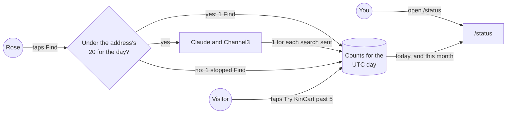

# Usage on status

**Version:** v1 · **Status:** Draft · **Type:** Feature · **Project type:** Web UI

**Shape doc:** docs/specs/security/shape.md
**Depends on:** find-limits
**Page:** none. Skipped: you read the `.md` directly.

`/status` shows how many Finds and Channel3 searches ran today and this month, and how many Finds and Try KinCarts the limits stopped. It comes second because find-limits can't stop a script on many addresses, and this page is how you see one before the quota runs out.

## Problem

Nothing counts Channel3 searches. `searchListings()` at `lib/shop/search.ts:17` sends each one, and one Find sends 0 to 10. When the month's ~1,000 searches run out, every judge's Find says "Couldn't find that", and that is the first sign you get.

find-limits stops one address at 20 Finds a day, but a script on 5 or more addresses can still use up the month (find-limits O3). Its `address_uses` table can't answer "how many this month": it keeps only each address's last 24 hours, and a stopped Find adds nothing to it.

## Slice test

| Check                         | Result |
| ----------------------------- | ------ |
| Cuts every layer it needs     | yes: the count lines on `/status`, the counting in `find()`, `start()` and the Channel3 call, and a table of counts |
| One e2e test walks it         | yes: a real Find and a stopped Find, then `/status` shows each one in its count |
| Worth shipping alone          | yes: you see a script using up the month's searches while there is still time to act |
| Fits (≤5 scenarios, ≤2 areas) | yes: 5 scenarios, in the shop's Find and storage in `lib/shop/`, and the `/status` page |

**Path:** full. It adds a table and new lines on `/status`.

## User story

As the person who runs KinCart, I want `/status` to show how many Finds and Channel3 searches ran today and this month, so that I see abuse before the quota runs out.

## Flow



Each Find, each Channel3 search, and each stop adds one to that UTC day's count, and `/status` adds up today and this month.

## Acceptance criteria

```gherkin
Scenario: You see today's and this month's use
  Given it is 14:00 UTC on Dec 3
  And today 38 Finds ran and sent 214 Channel3 searches, and the limits stopped 4 Finds and 1 Try KinCart
  And since Dec 1, 96 Finds ran and sent 540 searches, and the limits stopped 9 Finds and 2 Try KinCarts
  When you open /status
  Then the page shows 38 Finds today and 96 this month
  And it shows 214 Channel3 searches today and 540 of 1,000 this month
  And it shows 4 stopped Finds and 1 stopped Try KinCart today, and 9 and 2 this month
  And the Database, PayPal sandbox and Build lines show as they do today
  When the database stops answering and you reload
  Then each count line says "not reachable" in bold red, and the PayPal sandbox and Build lines still show

Scenario: A Find counts once, and each search it sends counts
  Given /status shows 38 Finds and 214 searches today
  When Rose types "batteries for the clock and a night light" and taps Find
  Then /status shows 39 Finds and 218 searches today, because each of the 2 things sends 2 searches
  When Rose taps Find with an empty box
  Then /status still shows 39 Finds and 218 searches
  When Rose taps Find for "a night light" and one of its 2 searches times out
  Then /status shows 40 Finds and 220 searches

Scenario: A stopped Find or Try KinCart counts only as stopped
  Given 20 Finds came from 203.0.113.7 in the last 24 hours
  And /status shows 40 Finds, 220 searches and 4 stopped Finds today
  When Rose at that address taps Find
  Then /status shows 40 Finds, 220 searches and 5 stopped Finds today
  Given 5 households started from 203.0.113.7 in the last 24 hours, and /status shows 1 stopped Try KinCart today
  When someone at that address taps Try KinCart
  Then /status shows 2 stopped Try KinCarts today

Scenario: The month's searches turn red from 800
  Given 798 Channel3 searches ran this month
  When you open /status
  Then the searches line says 798 of 1,000 this month, in the normal style
  When Rose taps Find for "a night light", which sends 2 searches, and you reload /status
  Then the searches line says 800 of 1,000 this month, in bold red like a failed check

Scenario: A new UTC day and month start from 0
  Given at 23:50 UTC on Nov 30, /status shows 12 Finds today and 410 this month
  When you open /status at 00:05 UTC on Dec 1
  Then it shows 0 Finds today and 0 this month
  And the searches and the stops show 0 today and 0 this month too
```

## Scope

**In:**

- Four counts on `/status`, each for today and this month, in UTC (O1, O2):
  - Finds that reached the AI. A Find counts where find-limits counts it: after the input checks, when it takes a place under the limit.
  - Channel3 searches. Every call sent counts, whatever Channel3 answers (O6).
  - Finds that the limit stopped.
  - Try KinCarts that the limit stopped, from Try KinCart and from Start a new one.
- The month's searches shown against 1,000, in bold red from 800 (O3). 1,000 is the assumed quota (find-limits O6).
- "not reachable" on each count line when the database doesn't answer, as the Database line says today.
- Counts from production only, from the day this ships (O5).
- Anyone can see the counts, as anyone can see `/status` today (O4).

**Out:**

- Claude calls. Anthropic's console shows the spend (O1). Not planned.
- New households that started. Only the stopped ones show (O1). Not planned.
- A push or an email when the searches reach 800. Not in the shape. It would be a slice of its own.
- Counts for each address or each household. Not planned.
- Months before this one, and a chart. Not planned.
- Channel3's own usage count, and searches from CI's e2e and local runs (O5). Not planned.
- A sign-in or a secret key for `/status` (O4). Not planned.

## Open items

| ID | What | Type | Raised at | Owner | Status | Answer |
| -- | ---- | ---- | --------- | ----- | ------ | ------ |
| O1 | Which counts `/status` shows | question | spec p1 | user | Resolved | Finds that reached the AI, Channel3 searches, Finds the limit stopped, and Try KinCarts the limit stopped. Stopped Finds only, and Claude calls too, were turned down. Anthropic's console shows the Claude spend. 2026-10-19 |
| O2 | What "today" and "this month" mean | question | spec p1 | user | Resolved | The UTC day and the UTC calendar month. The page already gives its times in UTC. The last 24 hours and the last 30 days were turned down. 2026-10-19 |
| O3 | Whether the searches show against Channel3's quota | question | spec p1 | user | Resolved | "540 of 1,000 this month", in bold red from 800. 1,000 is assumed (find-limits O6). The number alone was turned down. 2026-10-19 |
| O4 | Who may see the counts | question | spec p1 | user | Resolved | Anyone, as with the rest of `/status`. The counts hold no addresses or household data. A script writer can see how many searches are left. A secret key in the page address was turned down. 2026-10-19 |
| O5 | The page counts only production's searches, from the day this ships. CI's e2e and local runs use the same Channel3 key and don't show | flag | spec p1 | user | Accepted risk | Main freezes on Nov 5, so CI uses no searches during judging, and December's count is the whole month. Reading Channel3's own count was turned down. 2026-10-19 |
| O6 | Whether a Channel3 search that fails, such as a timeout or an HTTP 500, counts | question | spec p1 | user | Resolved | Every call sent counts. Nobody knows which failures Channel3 bills, so the page may count a few too many, never too few. Answered calls only was turned down. 2026-10-19 |

_Never delete this section or its rows. See references/ledger.md._

## Decisions to record

```
## D78 · 2026-10-19 · /status counts Finds, Channel3 searches, and stopped Finds and Try KinCarts, by the UTC day and month

Why: Channel3's ~1,000 searches a month run out first, and one Find sends 0 to 10, so the page shows both. The month's searches show "of 1,000", in bold red from 800. The stops show each limit at work. Every call sent counts, because nobody knows which failures Channel3 bills.
Rejected: Claude calls too (Anthropic's console shows the spend), stopped Finds only (a script that starts households would not show), the last 24 hours and 30 days (a calendar month reads straight against a monthly quota), answered calls only (too few if Channel3 bills failures), the number alone (you would do the sum yourself).
Source: docs/specs/usage-on-status.md
Status: active

## D79 · 2026-10-19 · Anyone can see the counts on /status

Why: `/status` has no sign-in, and the counts hold no addresses and no household data. A script writer learns how many searches are left, and the per-address limit still stops each address at 20 Finds.
Rejected: the counts only with a secret key in the page address (a new env value, and a link to keep, for numbers that hold nothing private).
Source: docs/specs/usage-on-status.md
Status: active
```

## Glossary

- **e2e** — an end-to-end test: a script drives a real browser through the app, the way a person would.
- **Quota** — the number of calls a free tier allows each month. Channel3's is about 1,000 searches.
- **UTC** — the world's reference clock. Midnight UTC is 8 am in Kuala Lumpur and 4 pm the day before in San Francisco.
