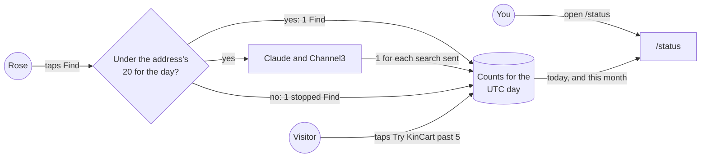
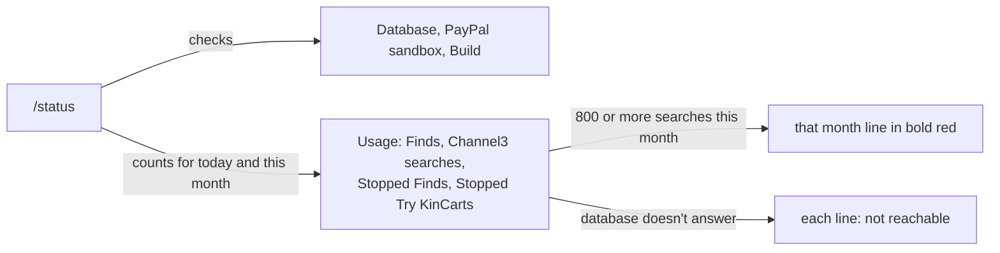
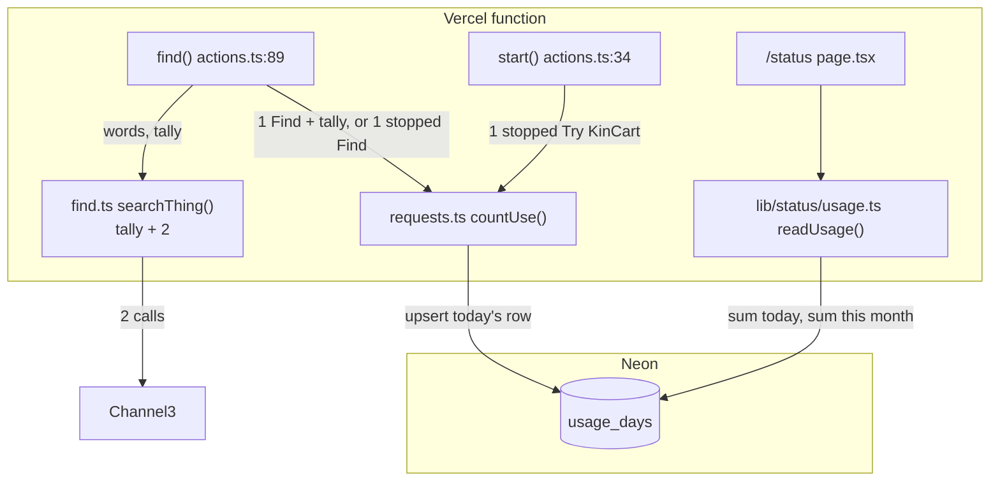
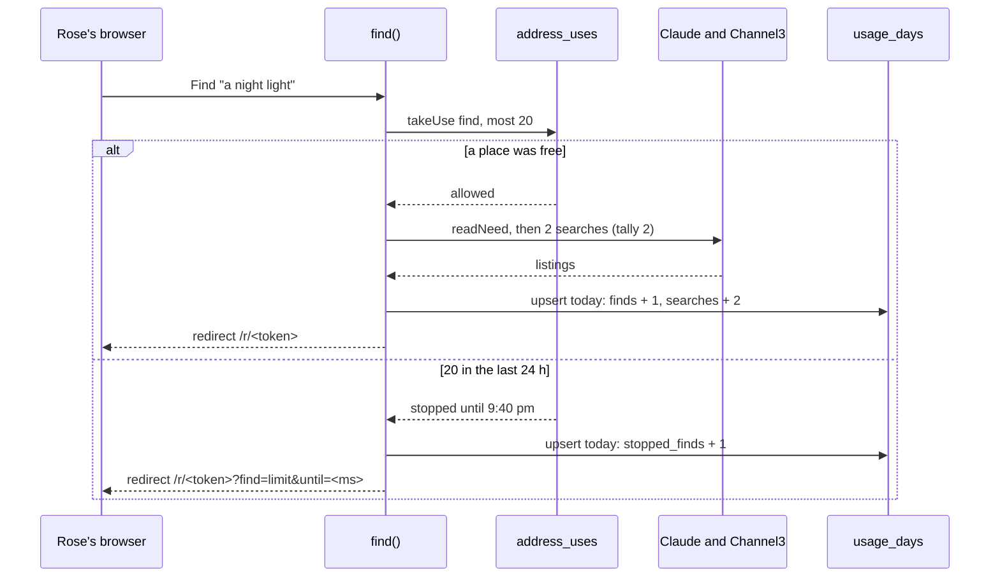
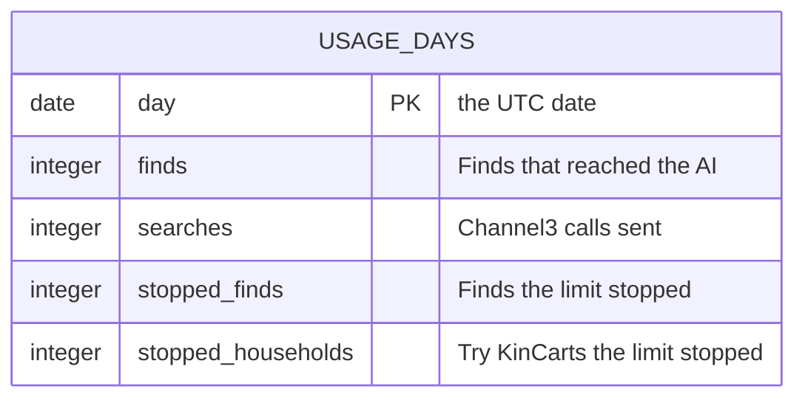

# Usage on status

**Version:** v1 · **Status:** Refined · **Type:** Feature · **Project type:** Web UI

**Shape doc:** docs/specs/security/shape.md
**Depends on:** find-limits
**Page:** none. Skipped: you read the `.md` directly.

`/status` shows how many Finds and Channel3 searches ran today and this month, and how many Finds and Try KinCarts the limits stopped. It comes second because find-limits can't stop a script on many addresses, and this page is how you see one before the quota runs out.

## Problem

Nothing counts Channel3 searches. `searchListings()` at `lib/shop/search.ts:17` sends each one, and one Find sends 0 to 10. When the month's ~1,000 searches run out, every judge's Find says "Couldn't find that", and that is the first sign you get.

find-limits stops one address at 20 Finds a day, but a script on 5 or more addresses can still use up the month (find-limits O3). Its `address_uses` table can't answer "how many this month": it keeps only each address's last 24 hours, and a stopped Find adds nothing to it.

## Slice test

| Check                         | Result |
| ----------------------------- | ------ |
| Cuts every layer it needs     | yes: the count lines on `/status`, the counting in `find()`, `start()` and the Channel3 call, and a table of counts |
| One e2e test walks it         | yes: a real Find and a stopped Find, then `/status` shows each one in its count |
| Worth shipping alone          | yes: you see a script using up the month's searches while there is still time to act |
| Fits (≤5 scenarios, ≤2 areas) | yes: 5 scenarios, in the shop's Find and storage in `lib/shop/`, and the `/status` page |

**Path:** full. It adds a table and new lines on `/status`.

## User story

As the person who runs KinCart, I want `/status` to show how many Finds and Channel3 searches ran today and this month, so that I see abuse before the quota runs out.

## Flow



Each Find, each Channel3 search, and each stop adds one to that UTC day's count, and `/status` adds up today and this month.

## Acceptance criteria

```gherkin
Scenario: You see today's and this month's use
  Given it is 14:00 UTC on Dec 3
  And today 38 Finds ran and sent 214 Channel3 searches, and the limits stopped 4 Finds and 1 Try KinCart
  And since Dec 1, 96 Finds ran and sent 540 searches, and the limits stopped 9 Finds and 2 Try KinCarts
  When you open /status
  Then the page shows 38 Finds today and 96 this month
  And it shows 214 Channel3 searches today and 540 of 1,000 this month
  And it shows 4 stopped Finds and 1 stopped Try KinCart today, and 9 and 2 this month
  And the Database, PayPal sandbox and Build lines show as they do today
  When the database stops answering and you reload
  Then each count line says "not reachable" in bold red, and the PayPal sandbox and Build lines still show

Scenario: A Find counts once, and each search it sends counts
  Given /status shows 38 Finds and 214 searches today
  When Rose types "batteries for the clock and a night light" and taps Find
  Then /status shows 39 Finds and 218 searches today, because each of the 2 things sends 2 searches
  When Rose taps Find with an empty box
  Then /status still shows 39 Finds and 218 searches
  When Rose taps Find for "a night light" and one of its 2 searches times out
  Then /status shows 40 Finds and 220 searches

Scenario: A stopped Find or Try KinCart counts only as stopped
  Given 20 Finds came from 203.0.113.7 in the last 24 hours
  And /status shows 40 Finds, 220 searches and 4 stopped Finds today
  When Rose at that address taps Find
  Then /status shows 40 Finds, 220 searches and 5 stopped Finds today
  Given 5 households started from 203.0.113.7 in the last 24 hours, and /status shows 1 stopped Try KinCart today
  When someone at that address taps Try KinCart
  Then /status shows 2 stopped Try KinCarts today

Scenario: The month's searches turn red from 800
  Given 798 Channel3 searches ran this month
  When you open /status
  Then the searches line says 798 of 1,000 this month, in the normal style
  When Rose taps Find for "a night light", which sends 2 searches, and you reload /status
  Then the searches line says 800 of 1,000 this month, in bold red like a failed check

Scenario: A new UTC day and month start from 0
  Given at 23:50 UTC on Nov 30, /status shows 12 Finds today and 410 this month
  When you open /status at 00:05 UTC on Dec 1
  Then it shows 0 Finds today and 0 this month
  And the searches and the stops show 0 today and 0 this month too
```

## Scope

**In:**

- Four counts on `/status`, each for today and this month, in UTC (O1, O2):
  - Finds that reached the AI. A Find counts where find-limits counts it: after the input checks, when it takes a place under the limit.
  - Channel3 searches. Every call sent counts, whatever Channel3 answers (O6).
  - Finds that the limit stopped.
  - Try KinCarts that the limit stopped, from Try KinCart and from Start a new one.
- The month's searches shown against 1,000, in bold red from 800 (O3). 1,000 is the assumed quota (find-limits O6).
- "not reachable" on each count line when the database doesn't answer, as the Database line says today.
- Counts from production only, from the day this ships (O5).
- Anyone can see the counts, as anyone can see `/status` today (O4).

**Out:**

- Claude calls. Anthropic's console shows the spend (O1). Not planned.
- New households that started. Only the stopped ones show (O1). Not planned.
- A push or an email when the searches reach 800. Not in the shape. It would be a slice of its own.
- Counts for each address or each household. Not planned.
- Months before this one, and a chart. Not planned.
- Channel3's own usage count, and searches from CI's e2e and local runs (O5). Not planned.
- A sign-in or a secret key for `/status` (O4). Not planned.

## Interface

`/status` gets a second list under a "Usage" heading, below the Database, PayPal sandbox and Build lines. Tokens come from the repo's design system, `docs/design/design-system/` (D15, D50).



The checks keep their list as today. The counts follow in a list of their own, and each count shows today on one line and this month on the next.

| State | What each count line shows |
| ----- | -------------------------- |
| Counts read | "38 today", then "96 this month". The searches line says "540 of 1,000 this month" |
| 800 or more searches this month | The searches line's month, such as "800 of 1,000 this month", in bold red. Today's line stays plain |
| New UTC day and month | "0 today", then "0 this month" |
| Database not reachable | "not reachable" in bold red, as the Database line says |
| No `DATABASE_URL` | "not configured" in bold red, as the Database line says |

The heading's note says "Today and this month, in UTC." Each list keeps its own label column, so the long "Stopped Try KinCarts" label doesn't push the Database line onto two lines. On a 390px phone, the red month line and the Database line take two lines each.

The design system keeps red for real failures. The month's searches use it from 800 because O3 chose it.

**Motion tier:** 0. The counts arrive with the page.

**Components used:** the status page's `dl` list and its `.fail` style, `.screen`, `.stack`, `.heading`, `.small`, and the `.screen h2` heading.

**Preview:** `/preview/usage-on-status`, with scenarios 1, 4 and 5 and the database down. Production returns 404. `StatusView` takes `usage` as optional for now, so `/status` works until `/build` reads the counts in `app/status/page.tsx` and makes it required.

## Technical plan

### Approach

A new table, `usage_days`, keeps one row for each UTC day, with four counters. `find()` and `start()` add to today's row with one upsert at the points where find-limits already decides. `/status` sums today's row and this month's rows in one query, beside its database and PayPal checks.

A Find's searches are counted where they are sent. `find()` and `findPhoto()` take a tally, and `searchThing()` adds 2 to it before its two Channel3 calls, as `reasons` is passed down today. After the search, `find()` writes the Find and the tally's searches in one upsert. A count that can't be written logs a line and never stops Rose's Find.

Relies on: D11, D12, D24, D46, D73, D74, D78, D79, D80, D81



The shop actions add to today's row, and `/status` reads the sums. Nothing else touches `usage_days`.



An allowed Find writes its count after the search, and a stopped Find writes only its stop. `/status` reads the row on its next load.

### Changes

| File | What changes | Why |
| ---- | ------------ | --- |
| `db/migrations/0012_usage_on_status.up.sql` | New: `CREATE TABLE IF NOT EXISTS usage_days (day date PRIMARY KEY, finds integer NOT NULL DEFAULT 0, searches integer NOT NULL DEFAULT 0, stopped_finds integer NOT NULL DEFAULT 0, stopped_households integer NOT NULL DEFAULT 0)` | Scenarios 1, 4 and 5 |
| `db/migrations/0012_usage_on_status.down.sql` | New: `DROP TABLE IF EXISTS usage_days` | Rollback |
| `scripts/migrate.test.ts:22` | `clear()` also empties `usage_days`. `downToHouseholds()` runs `0011_find_limits.down.sql` first. The first test expects `usage_days` after up, no `usage_days` and still `address_uses` after one down, and runs `0011_find_limits.down.sql` before its 0010 step. The second test runs `0011_find_limits.down.sql` before 0010 | The newest down file is now 0012 (learning: name `scripts/migrate.test.ts` in a plan that adds a migration) |
| `lib/shop/requests.ts:228` | New `countUse(use: Partial<Counts>)`. One `INSERT ... ON CONFLICT (day) DO UPDATE SET finds = usage_days.finds + EXCLUDED.finds, ...` for `(now() AT TIME ZONE 'UTC')::date`. On an error it logs `usage status=failed reason=<reason>` and returns | Scenarios 2 and 3. A count never stops a Find (D81) |
| `lib/shop/find.ts:29` | `find()` and `findPhoto()` take `sent: Sent = { searches: 0 }`, and pass it through `searchThings()` to `searchThing()`. `searchThing()` adds 2 just before its `Promise.all` at line 101. The `find outcome=` log line adds `searches=<n>` | Scenario 2: every call sent counts (O6) |
| `app/(shop)/actions.ts:101` | `find()`: a stopped Find calls `countUse({ stoppedFinds: 1 })` before its redirect. An allowed Find passes a tally to `findPhoto()` or `findOptions()`, then calls `countUse({ finds: 1, searches: sent.searches })` | Scenarios 2 and 3 |
| `app/(shop)/actions.ts:47` | `start()`: a stopped Try KinCart calls `countUse({ stoppedHouseholds: 1 })` before its redirect | Scenario 3 |
| `lib/status/usage.ts` | New `readUsage(url = process.env.DATABASE_URL)`, shaped like `checkDatabase()`: its own `pg` Client with 5 s timeouts, "not configured" without a URL, and "not reachable" with a reason on any error. One query sums today's row and the rows from the 1st of the UTC month | Scenarios 1 and 5 |
| `lib/status/database.ts:30` | Exports `reasonOf()` for `usage.ts` | Reuse |
| `app/status/page.tsx:16` | Reads `readUsage()` in the same `Promise.all`, passes it to `StatusView`, and adds `usage=ok`, `usage=not-reachable reason=<reason>` or `usage=not-configured` to the `status` log line | Scenario 1 |
| `app/status/StatusView.tsx:9` | `usage` becomes required | The page always passes it |
| `app/status/StatusView.tsx`, `status.css`, `app/(shop)/preview/usage-on-status/page.tsx` | Done at pause 2 (180b02c). `/build` adds their tests | Interface |
| `e2e/db.ts:23` | `reset()` also empties `usage_days`. New `usageToday(counts)` writes today's row | Each spec starts with no counts |
| `app/(shop)/actions.test.ts:67`, `lib/shop/requests.test.ts:51` | Their resets also empty `usage_days` | Counts don't leak between tests |
| `e2e/usage-on-status.spec.ts` | New. Walks scenarios 2 to 4 (below) | The slice's e2e |

Reusing: `query()` in `lib/shop/requests.ts`, `checkDatabase()`'s shape and `reasonOf()` from `lib/status/database.ts`, `reasonOf()` from `lib/shop/paypal.ts` for the shop side, `reasons` as the pattern for the tally, `usedFrom()` and `from()` from `e2e/find-limits.spec.ts`, and the pause 2 preview.

### Data



`usage_days` holds no household's data and no addresses, so D46's split doesn't apply. It grows by one row a day, and nothing deletes it.

**Migration:** expand only: one new table. Old code never reads it, so a rollback deploy keeps working. No backfill: the counts start at the deploy (O5).

**Reverse:** `node scripts/migrate.mjs down` runs `0012_usage_on_status.down.sql` and drops `usage_days`. `scripts/migrate.test.ts` runs up, down and up again.

### Earn-it

| Added | Triggered by |
| ----- | ------------ |
| `usage_days` table | Scenarios 1, 4 and 5: this month's totals and the stops. `address_uses` keeps 24 hours for each address and no stops |
| The `sent` tally in `find.ts` | Scenario 2: count each Channel3 call sent, with one write for each Find |
| `readUsage()` in `lib/status/usage.ts` | Scenario 1: the counts, and "not reachable" when the database doesn't answer |

### Non-functionals

|                      |                                                                               |
| -------------------- | ----------------------------------------------------------------------------- |
| **Load**             | About 100 Finds over judging. Each Find, stopped Find and stopped Try KinCart adds one upsert on its own connection, as every query in `requests.ts` does. Each `/status` load adds one query |
| **Breaks first**     | Nothing in this slice at 10 times the load. All writes in a day update one row, and each holds its lock for one statement. A flood of stopped Finds runs out Neon's connections first, as it does today without this slice |
| **Security surface** | Anyone can read the counts on `/status` (D79). `countUse()` runs inside `find()` and `start()`, and takes no input from the request. The table stores five numbers a day, with no addresses and no household data |
| **Proof it works**   | In Vercel's logs, `find outcome=... searches=<n>` for each Find, and `status ... usage=ok` for each `/status` load. A failed count logs `usage status=failed reason=<reason>` |
| **Rollout**          | No flag, and no new env value. Merge, CI migrates Neon after the tests (D11), and Vercel promotes. Before the migration runs, `countUse()` only logs, and `/status` says "not reachable" on the count lines. Rollback: revert the merge, and the old code ignores `usage_days`. Then `node scripts/migrate.mjs down` drops it |

### Test plan

| Scenario | Test | Command |
| -------- | ---- | ------- |
| 1 You see today's and this month's use | `lib/status/usage.test.ts`: rows for today and earlier this month give today's and the month's sums. No URL gives "not configured", and `127.0.0.1:1` gives "not reachable". `app/status/StatusView.test.tsx`: the four lines, "540 of 1,000", and "not reachable" in bold red on each line | `pnpm test` |
| 2 A Find counts once, and each search counts | `lib/shop/find.test.ts`: the tally equals the Channel3 calls `fetch` saw for a one-thing Find (2), a two-thing basket (4), a search that times out (2), and "too many" (0). `app/(shop)/actions.test.ts`: a typed Find adds 1 Find and its searches, and an empty box and a PDF add nothing. `lib/shop/requests.test.ts`: 30 `countUse()` calls at once add 30, and a bad `DATABASE_URL` logs and doesn't throw | `pnpm test` |
| 3 A stopped Find or Try KinCart counts only as stopped | `app/(shop)/actions.test.ts`: a Find past 20 adds 1 stopped Find and no Find, and a Try KinCart past 5 adds 1 stopped Try KinCart | `pnpm test` |
| 4 The month's searches turn red from 800 | `app/status/StatusView.test.tsx`: 799 is plain, and 800 puts `fail` on the month line only. The e2e (below) | `pnpm test`, `pnpm test:e2e e2e/usage-on-status.spec.ts` |
| 5 A new UTC day and month start from 0 | `lib/status/usage.test.ts`: a row for the last day of last month counts in neither sum, and a row for yesterday counts only in the month when yesterday is in this month | `pnpm test` |
| Migration | `scripts/migrate.test.ts` | `pnpm test` |

**E2E:** `e2e/usage-on-status.spec.ts` starts with 38 Finds and 798 searches today. Rose at 198.51.100.24 finds "a night light" for real (D24), and `/status` shows 39 Finds and "800 of 1,000 this month" in bold red. Then 20 Finds are seeded for 203.0.113.7, and a Find from there adds a stopped Find and leaves the Finds and searches as they were. Then 5 households are seeded, and a Try KinCart from there adds a stopped Try KinCart.

### Chunks

Single chunk. Every test file shares the local database, so the work runs serially (learning: build chunks one after another when their tests share the local database).

### Risks

| Risk | Mitigation |
| ---- | ---------- |
| A Find dies after its searches go out and before its count, so `/status` counts too few | Each Channel3 call times out after 5 s (`search.ts:23`), so a Find ends long before Vercel stops the function. The `find outcome=` line still shows `searches=<n>` when it ends |
| The count write fails during a Neon hiccup | `countUse()` logs `usage status=failed`, and Rose's Find goes on. The page counts too few for that moment |
| Channel3's real quota isn't 1,000 | `SEARCHES_A_MONTH` and `SEARCHES_RED` in `lib/status/usage.ts`. Check Channel3's dashboard before Dec 1 (find-limits O5) |
| CI and local runs use the same Channel3 key, and the page doesn't count them | Accepted at pause 1 (O5). Main freezes on Nov 5 |
| The deploy goes live before CI migrates Neon | `countUse()` only logs, and `/status` says "not reachable" on the count lines until `usage_days` exists |

### Decisions to record

Recorded as D78, D79, D80, D81.

## Open items

| ID | What | Type | Raised at | Owner | Status | Answer |
| -- | ---- | ---- | --------- | ----- | ------ | ------ |
| O1 | Which counts `/status` shows | question | spec p1 | user | Resolved | Finds that reached the AI, Channel3 searches, Finds the limit stopped, and Try KinCarts the limit stopped. Stopped Finds only, and Claude calls too, were turned down. Anthropic's console shows the Claude spend. 2026-10-19 |
| O2 | What "today" and "this month" mean | question | spec p1 | user | Resolved | The UTC day and the UTC calendar month. The page already gives its times in UTC. The last 24 hours and the last 30 days were turned down. 2026-10-19 |
| O3 | Whether the searches show against Channel3's quota | question | spec p1 | user | Resolved | "540 of 1,000 this month", in bold red from 800. 1,000 is assumed (find-limits O6). The number alone was turned down. 2026-10-19 |
| O4 | Who may see the counts | question | spec p1 | user | Resolved | Anyone, as with the rest of `/status`. The counts hold no addresses or household data. A script writer can see how many searches are left. A secret key in the page address was turned down. 2026-10-19 |
| O5 | The page counts only production's searches, from the day this ships. CI's e2e and local runs use the same Channel3 key and don't show | flag | spec p1 | user | Accepted risk | Main freezes on Nov 5, so CI uses no searches during judging, and December's count is the whole month. Reading Channel3's own count was turned down. 2026-10-19 |
| O6 | Whether a Channel3 search that fails, such as a timeout or an HTTP 500, counts | question | spec p1 | user | Resolved | Every call sent counts. Nobody knows which failures Channel3 bills, so the page may count a few too many, never too few. Answered calls only was turned down. 2026-10-19 |

_Never delete this section or its rows. See references/ledger.md._

## Glossary

- **e2e** — an end-to-end test: a script drives a real browser through the app, the way a person would.
- **Quota** — the number of calls a free tier allows each month. Channel3's is about 1,000 searches.
- **Upsert** — one statement that inserts a row, or updates it if it is already there.
- **Expand only** — a migration that only adds, so the old code still runs against the new schema.
- **Backfill** — filling a new table from data already there, before the code reads it.
- **Tally** — a running count passed into a function, which the function adds to.
- **UTC** — the world's reference clock. Midnight UTC is 8 am in Kuala Lumpur and 4 pm the day before in San Francisco.
